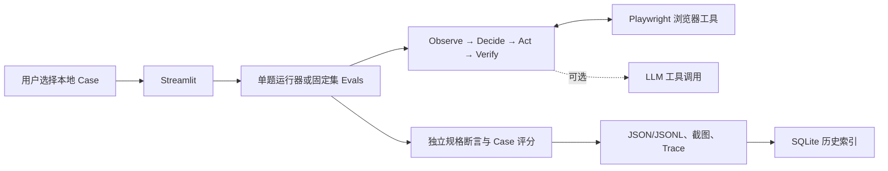

# WebProbe

**WebProbe 是一个面向本地 TestLab 的 Browser QA Agent 原型。**它用 Playwright 操作网页，让规则循环或 LLM 通过受限工具提出动作，再由 Python 根据固定规格检查页面状态。重点是把“页面真的有 Bug”“操作失败”“还没有足够证据”分开记录，并用固定 Evals 验证修改。

当前版本是可运行的本地 MVP：支持搜索、反馈表单、购物车和登录四类页面，共 30 条固定 Case；不支持任意网站和自由任务。项目使用 Streamlit 展示运行过程，运行时只访问本地 TestLab，服务绑定 `127.0.0.1`。

## 快速启动

需要 Windows PowerShell、Python 3.11+ 和本地 Chromium。第一次安装依赖：

```powershell
python -m venv .venv
.\.venv\Scripts\python.exe -m pip install -r requirements.txt
$env:PLAYWRIGHT_BROWSERS_PATH = Join-Path (Get-Location) '.browsers'
.\.venv\Scripts\python.exe -m playwright install chromium
```

之后启动界面：

```powershell
.\run_webprobe.ps1
```

规则策略不需要 API Key。打开界面后，在“运行测试”选择 TestLab 功能、固定 Case、策略和单题预算。建议先跑购物车 `cart_mixed_products_001`，再跑故障 Case `cart_wrong_total_001`；演示步骤见[演示指南](docs/demo_guide.md)。

要在命令行运行购物车七题固定评测：

```powershell
$env:PLAYWRIGHT_BROWSERS_PATH = Join-Path (Get-Location) '.browsers'
.\.venv\Scripts\python.exe -m webprobe.cart_evals --policy rule
```

每次运行会在 `artifacts/` 下保存逐题 JSONL、截图、Playwright Trace 和摘要。该目录被 Git 忽略；用于复核的规则对照聚合数据保存在[实验报告](evals/reports/2026-11-16_rule_comparison.json)。

## Agent 怎么工作



- **受限浏览器操作**：每题使用隔离的浏览器上下文；动作有步骤和时间上限，浏览器访问只允许该 Case 指定的本地页面。
- **确定性验证**：Ground Truth 来自人工维护的数据集和 TestLab 规格，不由受测 Agent 生成。LLM 提议动作或报告疑似 Bug，Python 仍要检查真实页面证据。
- **受控复查**：例如购物车总价异常会重新打开干净页面并重放相同操作；重复异常才形成疑似 Bug。超时、工具错误或未完成任务不会直接记成无 Bug。
- **可复查轨迹**：记录可见决策摘要、工具动作、页面观察、断言、失败类别、截图和 Playwright Trace。不会记录模型不可见的内部推理。
- **独立评测**：Evals 按一个 Case 统计 TP、FP、FN、TN；未形成结论的 Case 单列，不计入 TN。还记录任务成功率、恢复率、步骤、延迟和可获得的 Token 用量。

## 固定数据集与规则实验

2026-11-16 在四套本地固定数据集上运行了 Baseline/当前规则策略对照：

| 测试集 | Case 数 | Baseline 任务成功 | 当前规则任务成功 | 当前规则 TP / FP / FN / TN |
|---|---:|---:|---:|---:|
| 搜索 | 4 | 3/4 | 4/4 | 1 / 0 / 0 / 3 |
| 反馈表单 | 13 | 9/13 | 13/13 | 4 / 0 / 0 / 9 |
| 购物车 | 7 | 5/7 | 7/7 | 2 / 0 / 0 / 5 |
| 登录 | 6 | 4/6 | 6/6 | 2 / 0 / 0 / 4 |

这些结果来自**固定 TestLab 上的规则策略**，不是 LLM 成绩。Baseline 是“不复查疑似故障”的规则消融策略，不是基础 LLM。正例里有同一故障家族的重复 Case；数据规模小，不能据此宣称能泛化到任意网站或具有统计显著的性能提升。实验报告保留数据集哈希、策略源码哈希、运行 ID、逐项汇总和限制说明。

### LLM 验证状态

搜索、反馈表单和购物车支持可选 LLM 策略，登录目前为规则策略。搜索和表单的历史 Gemini 实验记录了真实请求及其失败；例如搜索单题曾经历超时，也曾在后续运行中复现一个预设错配故障。反馈表单旧版评测出现过服务失败和预算耗尽。购物车 LLM 路径目前通过**假模型响应 + 本地 Chromium**验证，没有新的真实模型评测结果。历史数字不代表当前版本的整套模型能力，也没有可靠的 API 费用估算。

如要运行真实模型，复制 `.env.example` 为 `.env` 并填写本机配置。模型运行会向所选服务发请求，可能使用额度或产生费用；启动本地界面和运行规则策略都不会调用模型。不要把真实密钥提交到 Git，也不要向模型发送真实用户数据。

## 自动化测试

项目使用本地 Chromium 和 TestLab 测试。模型循环的自动化测试使用预写响应，不会发起外部模型请求；它验证动作协议、浏览器接线、预算和 Python 侧的证据校验，不代表模型自主决策成绩。运行全量测试：

最近一次全量回归（2026-11-16）为 **175 条通过，126.23 秒**，包含固定评测报告的数据集哈希、Case 数和混淆矩阵完整性检查。

```powershell
$env:PLAYWRIGHT_BROWSERS_PATH = Join-Path (Get-Location) '.browsers'
$testTemp = Join-Path (Get-Location) (".tmp\pytest-" + [guid]::NewGuid().ToString("N"))
New-Item -ItemType Directory -Path $testTemp | Out-Null
.\.venv\Scripts\python.exe -m pytest -q -p no:cacheprovider --basetemp $testTemp
```

## 目录结构

```text
webprobe/                    Agent 循环、浏览器工具、数据集、评分与 UI
lab/                         本地 TestLab HTML 页面
evals/datasets/              固定 Case 与 Ground Truth（JSONL）
evals/reports/               可版本控制的实验聚合结果
tests/                       浏览器、Agent、Evals 和 UI 辅助测试
docs/demo_guide.md           演示流程与面试讲解提纲
docs/development_history.md  详细开发与学习记录
artifacts/                   本机运行产物（截图、Trace、SQLite；Git 忽略）
```

LangChain 和 LangGraph 各有独立的学习示例，位于 `webprobe/langchain_intro.py` 与 `webprobe/langgraph_intro.py`；主 Agent 循环使用普通 Python 控制流，避免为简单流程引入不必要的编排依赖。需要运行示例时再安装 `requirements-langchain.txt`。

## 安全与范围

- Streamlit 只监听 `127.0.0.1`；第一版界面只运行本地 TestLab 固定 Case。
- 不访问任意外部网站，不执行真实支付、删除或对外发布操作。
- 页面内容视为不可信数据，不作为 Agent 系统指令。
- 当前 DOM 观察和动作覆盖固定 TestLab 的结构，不是通用网站定位器。

详细的历史实验、学习笔记和框架练习保留在[开发记录](docs/development_history.md)。
